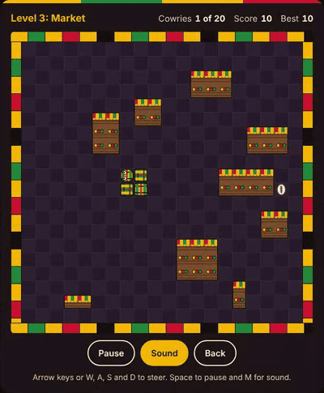
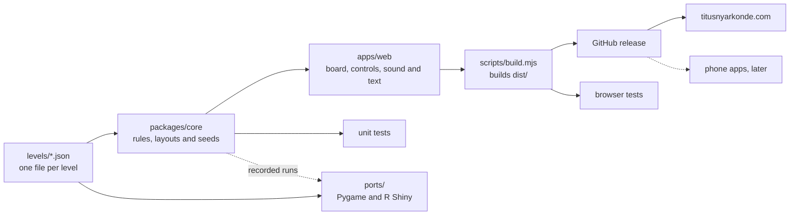

# Sankofa Snake

Sankofa Snake is a free snake game in kente colors. You steer a snake of woven kente blocks to collect cowrie shells, and each level adds a new world and one new rule. The logo is the Sankofa bird, the Akan symbol of a bird that turns its head back to pick up an egg from its back.

Play it at [titusnyarkonde.com/games/sankofa-snake](https://titusnyarkonde.com/games/sankofa-snake/).

[](https://github.com/Dr-Titus100/sankofa-snake/actions/workflows/ci.yml)



## Levels

| Level | World | What's new |
| --- | --- | --- |
| 1 | Farm | Learn the controls. The edges wrap around and the speed stays the same. |
| 2 | Park | The snake speeds up after every 5 cowries. |
| 3 | Market | Market stalls block parts of the board, in new places every run. |
| 4 | City | Solid walls. Hitting the edge of the board ends the run. |
| 5 | Road | Trotros and taxis drive across the board, and on some runs the roads cross. Vehicles stop for the snake and for each other, so only the snake's head can hit one. |
| 6 | Lab | Power-ups appear for a short time. Slow motion slows the snake down, shrink makes it shorter, and a pass lets it through its own tail once. |
| 7 | Maze | Narrow corridors with little room to turn, and a new maze every run. |
| 8 | Ocean | Currents push the snake one square sideways when it swims across them. Swimming along them speeds the snake up, and swimming against them slows it to half speed. |
| 9 | Weaving village | Every challenge at once: walls, looms, trotros, currents and power-ups, at top speed. |

Every run places the stalls, buildings, roads, lab benches, currents, canoes and looms somewhere new, and the Maze is a new maze each time. The snake's starting cells and the cells just ahead of it stay clear, and the snake can reach every open cell.

Eat 20 cowries to clear a level and open the next one. Clearing a level earns one star, and a high score with a fast finish earns up to two more.

## Other ways to play

The daily challenge changes every day. The date picks a world, its edges, a pace and whether power-ups appear, and the layout and the cowries are the same for everyone that day. Clear it on days in a row to build a streak.

Free play is the classic game in any world you have opened, with wrap-around edges or walls. It has no goal and goes on until the snake crashes. The game keeps your best cowrie count for each world.

Practice opens every level at a slower, steady speed. Running into something only stops the snake until you pick a new direction, so it works well for a class demo.

## Controls

- Arrow keys or W, A, S and D steer. On a phone or tablet, press the arrow buttons under the board, or swipe on the board. Swipes work with a finger, a pen or a mouse.
- Space, P or Escape pauses. On a phone, tap the board.
- M turns the sound off or on. The How to play screen has switches for sound and for vibration on phones that support it.
- The game pauses on its own when you switch tabs or apps.
- On a phone or tablet, the rules talk about the arrow buttons, swipes and taps, and leave out the keys. Turned sideways, the arrows sit beside the board with Pause, Sound and Back.
- Reset progress on the How to play screen deletes your scores, stars, cleared levels, streak and free play bests after it asks you to confirm. The sound and vibration switches stay.

## Sound and vibration

Each event has a short sound: a cowrie, a power-up, a current, a crash and a cleared level. Each cowrie in a run plays the next note up a five-note scale. Every world plays its notes on its own instrument: the gyil, a wooden xylophone from the Upper West of Ghana, on the Farm, a bamboo flute in the Park, an iron bell in the Market, a guitar string in the City, a horn on the Road, a glass chime in the Lab, a low log drum in the Maze, water drops in the Ocean, and the gyil and the bell together in the Weaving village. The browser makes every one of these sounds in code with the Web Audio API, so the game loads no sound files. On phones that support it, eating, crashing and clearing a level also give a short buzz.

## Teaching

The [teaching guides](docs/teaching/README.md) use the game's code to teach programming, with questions on paper, exercises at the keyboard and notes for the teacher. There are six lessons: the grid and how the snake moves, rules as functions, levels as data, randomness and seeds, the game loop and timing, and collision checks. They come in three languages: [TypeScript](docs/teaching/README.md) with the web game, [Python](docs/teaching/python/README.md) with the Pygame version, and [R](docs/teaching/r/README.md) with the R Shiny version.

## Where the code lives



```text
packages/core/   the rules in TypeScript, with no drawing, and their unit tests
levels/          one data file per level: size, edges, speed, goal and obstacles
apps/web/        the canvas game, its styles, its words in text.ts, and its tests
scripts/         the build script
docs/teaching/   lesson guides with exercises
ports/pygame/    the game for Python and Pygame, in a window on a computer
ports/shiny/     the game for R Shiny, in a browser
ports/reference/ runs recorded from the TypeScript rules, which both ports must match
```

The rules and the drawing live in separate folders on purpose. `packages/core` decides where the snake goes, what it eats and when a run ends. `apps/web` only draws the board and reads the keyboard and touch screen. The same rules will run the phone apps later.

The game also comes in two more languages. `ports/pygame` plays it in a window with Python and Pygame, and `ports/shiny` plays it in a browser from R with Shiny. Each has its own copy of the rules, ported line by line, and both read the same level files. Their tests replay runs recorded from the TypeScript rules and check every move, so all three play the same game. [ports/README.md](ports/README.md) explains how to run them.

A level is a data file. The Market's stalls, for example, are the `#` characters in `levels/03-market.json`, and `levels/05-road.json` lists the Road's trotros and taxis under `vehicles`, each with its lane, direction, length and speed. Currents are the arrows `<`, `>`, `^` and `v` in the Ocean's map. The Lab's `powerUps` setting says which power-ups can appear, how often and for how long. Adding a level means adding a file and listing it in `packages/core/src/levels.ts`. A test checks every level file for mistakes, such as a snake that starts on an obstacle.

The map in a level file is a template. `newLayout` in `packages/core/src/layout.ts` takes its obstacle pieces, currents and roads and places them somewhere new for each run. With two or more roads, half of the runs have roads that cross and half have roads that all run the same way. Parallel roads stay at least 4 cells apart, farther than the longest vehicle, so vehicles waiting at a crossing never block each other for good. A level with `"layout": "maze"` gets a new maze, and `"layout": "fixed"` keeps the map exactly as drawn. Add `?layout=fixed` to the game's address to play every level as its file draws it.

The cowries land in random places, but the random numbers come from a seed. The same seed always gives the same game, layout included, which the tests and the daily challenge rely on. Add `?seed=42` to the game's address to try it.

## Working on it

You need Node.js 22 and Python 3 (the browser tests use Python's small web server). The browser tests need Chromium and WebKit, which `npx playwright install chromium webkit` installs.

```sh
npm install
npm test            # unit tests for the rules, saved progress, the sounds and the paint
npm run build       # builds dist/
npm run test:e2e    # plays the built game in a desktop browser, an Android phone and an iPhone (WebKit)
npm run dev         # rebuilds on every change at http://localhost:5173
npm run clip        # records the gameplay clip in docs/media again
```

### Packages and install scripts

The game ships no packages. The five packages in `package.json` are tools for building and testing, each pinned to an exact version in `package-lock.json`. Two of the packages they pull in run a script when they install. Both scripts are normal.

- `esbuild` checks that its build program for your system is in place.
- npm installs `fsevents` only on macOS, where it watches files for changes.

If a new package ever adds an install script, `package-lock.json` shows `"hasInstallScript": true` on it. Check it before you merge. Dependabot opens pull requests for package and GitHub Actions updates each week, and waits until a new version has been out for 14 days. CodeQL scans the code and the workflows on every push and pull request.

## Tests

Every push and pull request runs the checks in GitHub Actions, and the badge at the top shows how the latest run on `main` went.

| Check | What it covers | Count |
| --- | --- | --- |
| `npm run typecheck` | Types across the rules, the web game and the tests | The whole project |
| `npm test` | Unit tests for the rules, the layouts, the levels, saved progress, the sounds and the paint on vehicles and canoes | 96 tests |
| `npm run test:e2e` | The built game played in a desktop browser, an Android phone and an iPhone (WebKit) | 50 tests on each, skipping the few that apply to another kind of device |
| Pygame tests | The Python rules replaying every recorded run, and the Pygame screens, controls, saving and sounds | 21 tests |
| Shiny tests | The R rules replaying every recorded run, and the Shiny server's screens, controls and saving | 932 checks |

The browser tests also check that the game makes no network requests, which keeps the "Data not collected" answer true for the app stores.

`npm run clip` records `docs/media/gameplay.gif` again after a change to the look. A small computer player steers the snake on the Market while a browser films it. It needs ffmpeg.

## Using the game on a page

`npm run build` writes four files to `dist/`: `sankofa-snake.js`, `sankofa-snake.css`, `sankofa-logo.svg` and a stand-alone `index.html`, plus `SHA256SUMS`. To put the game on any page, load the script and the stylesheet and add an element with a `data-sankofa-snake` attribute:

```html
<link rel="stylesheet" href="sankofa-snake.css" />
<div data-sankofa-snake></div>
<script type="module" src="sankofa-snake.js"></script>
```

Give the attribute the value `play` to leave out the How to play button, or `help` to show only the rules and the sound and vibration switches. A site can use the two to put the rules on a tab of their own, the way titusnyarkonde.com does.

When the screen changes, the game scrolls the page back to its own top if the player had scrolled past it. A page with a sticky header can set `--ss-scroll-margin` on the element, such as `--ss-scroll-margin: 80px`, so the header doesn't cover the game.

Each element keeps its game as `element.sankofaSnake`, and the script also exports the `SankofaSnake` class, so a page or an app can control it:

```js
import { SankofaSnake } from "./sankofa-snake.js";

const game = new SankofaSnake(document.querySelector("#game"), { layout: "new" }); // "fixed" keeps every map as drawn
game.back();    // pauses a run, then goes back one screen. Returns false on the title screen.
game.destroy(); // stops the board, closes the sound and removes every listener
```

The phone apps call `back()` from the Android back button and close only when it returns false.

All the text the game shows or says is in `apps/web/src/text.ts`, ready for a translation. The level names and challenges are in the level files.

## Releases

The release workflow tests and builds the game, then attaches the built files to a GitHub release. Its build job has read-only access, and only the publish job, which runs no package code, can write to the repo. Pushing a tag such as `v0.1.1` starts it. You can also start it by hand from the Actions tab with the tag name, and it creates the tag for you. The website pins one release and checks each file's checksum before it serves the game.

## Privacy

The game keeps scores, progress, the daily streak and the sound and vibration switches in your browser's local storage. It sends nothing to any server and has no ads or trackers. Its own page has a Content Security Policy that blocks every network request, and a browser test fails if the game ever makes one.

On a website the game shares storage with every other page, so it checks every saved value when it loads and drops anything that doesn't fit, such as a score that isn't a whole number or more than 3 stars. The save carries a version number, so a later release can change the format without losing anyone's progress. If the browser won't let the game save, as in some private windows, the game says so.

## Credits

This game started from a snake game Titus built in R Shiny, which grew out of [Adam Spannbauer's shiny_snake_loader](https://github.com/AdamSpannbauer/shiny_snake_loader) (MIT license). Sankofa Snake is a fresh rewrite and shares no code with it.

The game draws the kente patterns and the Sankofa bird in code. They draw on kente cloth and Adinkra symbols from Ghana and don't copy any named cloth design.

[ART.md](ART.md) records how Titus made each drawing and sound.

## License

The game comes under the Sankofa Snake License, in [LICENSE](LICENSE).

You can copy, change, teach with and share the code for free, as under the MIT license, with two limits. Without Titus's written permission, you can't publish the game or a version of it in an app store, such as the App Store or Google Play, and you can't make a 3D version of it. Titus has plans for both. From 20 November 2026, every version you get from this repo or its releases, including those from before 0.10.0, comes under this license. Copies given out under the MIT license before that date, and copies passed on from them, keep the MIT rights.

The name "Sankofa Snake", the bird logo and the store art stay with the official game, so a copy needs its own name and logo. See [TRADEMARKS.md](TRADEMARKS.md).
